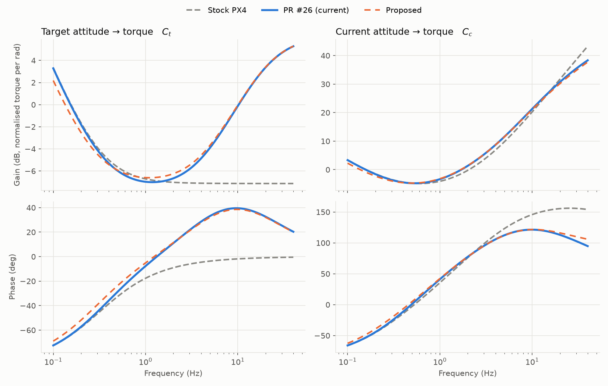

# Replacing PR #26 with an Attitude Feed-Forward

Our custom PX4 (PR #26) adds the derivative of the target rate to the rate controller's D term. This gives an extra "push" during sharp changes to the target, for example hard braking.

This document shows the same behaviour can be had from the stock PX4 rate controller, retuned gains and one feed-forward term in the attitude loop.

**Notation.**

- $\theta$, $\theta_T$ current and target attitude; $\omega$, $\omega_T$ current and target rate; $e = \omega_T - \omega$.
- $\omega$ is the gyro rate after PX4's gyro low pass filter, $\omega = G\cdot\omega_\text{raw}$, where $G = \frac{\omega_g^2}{s^2 + \sqrt{2}\,\omega_g s + \omega_g^2}$ is second-order Butterworth with cut-off `IMU_GYRO_CUTOFF`. All the controllers use this filtered $\omega$, so $G$ does not appear in their equations.
- $\tau$ normalised torque, nominally $[-1, 1]$.
- $s$ the Laplace variable: multiplying by $s$ differentiates, dividing by $s$ integrates.
- $K_a$ = `MC_ROLL_P`; $K_p$, $K_i$, $K_d$ = `MC_ROLLRATE_K` times `MC_ROLLRATE_P`, `_I`, `_D`. Pitch is the same with `PITCH`.
- $H = \frac{\omega_h}{s + \omega_h}$ the stock D filter (`IMU_DGYRO_CUTOFF`); $F = \frac{\omega_f}{s + \omega_f}$ the PR #26 D filter (`MC_PR_D_CUTOFF`), with $\omega = 2\pi f$.
- A hat marks a proposed value, e.g. $\hat K_p$.

**Assumptions.** Roll and pitch only, since yaw has no D term. Small angles, so $\theta_T - \theta$ is a 3-vector. Linear: no rate limit and no motor saturation. Continuous time, which matches the 400 Hz loop below about 40 Hz.

## Stock PX4

The attitude loop is proportional only, and the rate loop is a PID with the D term on the measured rate:

$$\omega_T = K_a\cdot(\theta_T - \theta) \tag{1}$$

$$\tau = \Big(K_p + \frac{K_i}{s}\Big)\cdot e - K_d\cdot H\cdot s\omega \tag{2}$$

## PR #26

PR #26 adds the target rate's derivative to the D term and filters the whole D term with $F$:

$$\tau = \Big(K_p + \frac{K_i}{s}\Big)\cdot e + K_d\cdot F\cdot(s\omega_T - H\cdot s\omega) \tag{3}$$

Differentiating (1), and writing $\Delta K_p = K_d\cdot K_a$:

$$K_d\cdot s\omega_T = \Delta K_p\cdot(s\theta_T - \omega) \tag{4}$$

So PR #26's extra term is a second proportional rate term. Its setpoint is the target's own rate $s\theta_T$, rather than the attitude loop's request $\omega_T$.

Despite its name, the term is not only driven by the target: $-\Delta K_p\cdot\omega$ is extra damping on the drone's own rate, which changes the feedback loop as well as tracking. PR #26 gets this $\omega$ by differentiating the attitude estimate, rather than from the gyro.

## Proposed

The rate controller is vanilla PX4 (2) with retuned gains. The attitude loop gains a feed-forward on the target's rate:

$$\hat\omega_T = \hat K_a\cdot(\theta_T - \theta) + K_{ff}\cdot F\cdot s\theta_T \tag{5}$$

$$\tau = \Big(\hat K_p + \frac{K_i}{s}\Big)\cdot e - \hat K_d\cdot\hat H\cdot s\omega \tag{6}$$

with

$$\hat K_p = K_p + \Delta K_p \qquad \hat K_a = \frac{K_p\cdot K_a}{\hat K_p} \qquad K_{ff} = \frac{\Delta K_p}{\hat K_p} \qquad \hat K_d = K_d\cdot\Big(1 - \frac{K_a}{\omega_f}\Big) \qquad \frac{1}{\hat\omega_h} = \frac{1}{\omega_f} + \frac{1}{\omega_h}$$

[Appendix A](#appendix-a-derivation) derives (5) and (6) by rearranging (3) into stock PX4 terms. They reproduce PR #26 apart from three small differences:

- $\hat K_d$ approximates $H \approx 1$ in a small term (A9).
- One filter $\hat H$ replaces the two in series, $F\cdot H$ (A10).
- The integral on attitude error is $K_{ff}$ (14%) weaker (A11, A12).

The only code change is the feed-forward in (5). It goes in the attitude controller next to the existing yaw feed-forward (`AttitudeControl.cpp`), before the rate limit.

### PX4 Implementation

PX4 uses quaternions for attitude. When attitude setpoint $k$ arrives, the change in the target's attitude since setpoint $k-1$ is

$$q_{T_{k-1}\leftarrow T_k} = q_{G\leftarrow T_{k-1}}^*\otimes q_{G\leftarrow T_k}$$

The logarithmic map turns it into a rotation vector, the axis times the angle turned:

$$\phi = \text{Log}(q_{T_{k-1}\leftarrow T_k})$$

We remove its part about the world's vertical $z$, expressed in the target's frame. Yaw has its own feed-forward, and heading resets are rotations about the vertical:

$$\phi_\perp = \big(I - z\,z^\top\big)\cdot\phi, \qquad z = R\big(q_{G\leftarrow T_k}\big)^\top\cdot\begin{bmatrix}0\\0\\1\end{bmatrix}$$

Dividing by the $\Delta t$ between the two setpoints and rotating into the drone's body frame gives the target's rate:

$$s\theta_T \approx R\big(q_{G\leftarrow B}^*\otimes q_{G\leftarrow T_k}\big)\cdot\frac{\phi_\perp}{\Delta t}$$

$F$ is a first-order `AlphaFilter` with cut-off `MC_ATT_FF_CUTOFF`, applied in the target's frame when each setpoint arrives and held until the next. $K_{ff}$ is `MC_ATT_FF`, and only the body roll and pitch of $K_{ff}\cdot F\cdot s\theta_T$ are added to (5).

## Parameter Values

| | Current (PR #26) | Proposed |
|---|---|---|
| `MC_ROLL_P` ($K_a$) | 5.5 | 4.74 |
| `MC_ROLLRATE_K` | 0.08 | 0.08 |
| `MC_ROLLRATE_P` ($K_p$ / K) | 1.0 | 1.16 |
| `MC_ROLLRATE_I` ($K_i$ / K) | 2.0 | 2.0 |
| `MC_ROLLRATE_D` ($K_d$ / K) | 0.029 | 0.0277 |
| `IMU_DGYRO_CUTOFF` | 120 Hz | 17 Hz |
| `MC_PR_D_CUTOFF` | 20 Hz | removed |
| `MC_ATT_FF` ($K_{ff}$) | | 0.138 |
| `MC_ATT_FF_CUTOFF` ($F$) | | 20 Hz |

Pitch uses the same values.

## Comparison

The controller is linear and has two inputs, the target and the current attitude, so it is described by two transfer functions:

$$\tau = C_t\cdot\theta_T - C_c\cdot\theta \tag{7}$$

| Controller | $C_t$ | $C_c$ |
|---|---|---|
| Stock PX4 | $(K_p + \frac{K_i}{s})\cdot K_a$ | $(K_p + \frac{K_i}{s})\cdot(s + K_a) + K_d\cdot H\cdot s^2$ |
| PR #26 | $(K_p + \frac{K_i}{s})\cdot K_a + \Delta K_p\cdot F\cdot s$ | $(K_p + \frac{K_i}{s})\cdot(s + K_a) + \Delta K_p\cdot F\cdot s + K_d\cdot F\cdot H\cdot s^2$ |
| Proposed | $(\hat K_p + \frac{K_i}{s})\cdot(\hat K_a + K_{ff}\cdot F\cdot s)$ | $(\hat K_p + \frac{K_i}{s})\cdot(s + \hat K_a) + \hat K_d\cdot\hat H\cdot s^2$ |

If both transfer functions match, the controllers behave the same. Substituting $s = j\cdot 2\pi f$ gives each one's gain and phase at frequency $f$. Stock uses the current, un-retuned gains.

The comparison takes $\omega = s\theta$, i.e. $G \approx 1$, which holds well below `IMU_GYRO_CUTOFF` (40 Hz), so the plots are approximate from 20 to 40 Hz.

- **Target attitude to torque.** Stock goes flat above about 1 Hz: it is missing PR #26's push. The proposal keeps it, within 0.4 dB and 3° above 1 Hz.
- **Current attitude to torque.** The proposal matches PR #26 within 0.5 dB and 3° from 1 to 20 Hz. From 20 to 40 Hz the phase separates by up to 11°, from (A10): one D filter instead of two, which also lets slightly more gyro noise reach the motors.
- **Below 1 Hz.** Both differ by up to 1.1 dB, from the weaker integral, (A11) and (A12).

Stock PX4 differs from PR #26 by up to 10 dB and 42° from 1 to 20 Hz.

## Why the Attitude Loop

**Compared with PR #26**, the proposal does the same thing with each effect in its own place:

- **Damping is a feedback gain.** PR #26's $-\Delta K_p\cdot\omega$ is hidden in the D term. The proposal puts it in $\hat K_p$, where it is tuned and analysed like any other rate gain.
- **The push has its own gain.** In PR #26 the push is $K_d\cdot K_a$, so retuning `MC_ROLLRATE_D` or `MC_ROLL_P` silently changes it. In the proposal it is $K_{ff}$ alone.
- **The rate limit applies.** The feed-forward is part of the rate setpoint, so `MC_ROLLRATE_MAX` bounds it.
- **Stock rate controller.** The only custom code is the feed-forward in the attitude controller, about 20 lines plus two parameters, next to PX4's own yaw feed-forward.

**Compared with a torque feed-forward**, putting $\Delta K_p\cdot F\cdot s\theta_T$ into the torque (6) instead of the rate setpoint (5): in a sustained turn the integrator cancels a torque feed-forward, so the drone lags the target by 0.21 s instead of PR #26's 0.18 s. In the attitude loop the feed-forward is part of the rate setpoint, which the integrator tracks, so the lag matches.

## Other Changes

- PR #26 runs the rate loop at `IMU_INTEG_RATE` (400 Hz). On v1.17, set `IMU_GYRO_RATEMAX` = 400 for the same.
- v1.17 adds a yaw torque low pass, `MC_YAW_TQ_CUTOFF`. Set it to 0 to match v1.13, which the yaw gains were tuned for.

## Appendix A: Derivation

Substituting (4) into (3):

$$\tau = \underbrace{K_p\cdot e}_{\text{Proportional}}
  + \underbrace{\frac{K_i}{s}\cdot e}_{\text{Integral}}
  + \underbrace{\Delta K_p\cdot F\cdot s\theta_T - \Delta K_p\cdot F\cdot\omega - K_d\cdot F\cdot H\cdot s\omega}_{\text{Derivative}} \tag{A1}$$

The PR #26 derivative term has three parts:

- a feed-forward on the target's rate, $\Delta K_p\cdot F\cdot s\theta_T$
- a part proportional to the current rate, $-\Delta K_p\cdot F\cdot\omega$
- the stock derivative, filtered more heavily, $-K_d\cdot F\cdot H\cdot s\omega$

We now move each part into a stock PX4 term.

### Splitting the filter

Since $F\cdot(s + \omega_f) = \omega_f$, dividing by $\omega_f$ and rearranging gives

$$F = 1 - \frac{s}{\omega_f}\cdot F \tag{A2}$$

Applying this to the part proportional to the current rate:

$$-\Delta K_p\cdot F\cdot\omega = -\Delta K_p\cdot\omega + \frac{\Delta K_p}{\omega_f}\cdot F\cdot s\omega \tag{A3}$$

The first part of (A3) joins the proportional term, and the second part joins the derivative term.

### Proportional

Expanding the proportional term using (1):

$$K_p\cdot e = K_p\cdot K_a\cdot(\theta_T - \theta) - K_p\cdot\omega \tag{A4}$$

Adding the first part of (A3) and the feed-forward from (A1):

$$K_p\cdot e - \Delta K_p\cdot\omega + \Delta K_p\cdot F\cdot s\theta_T = K_p\cdot K_a\cdot(\theta_T - \theta) + \Delta K_p\cdot F\cdot s\theta_T - (K_p + \Delta K_p)\cdot\omega \tag{A5}$$

Taking out $\hat K_p = K_p + \Delta K_p$:

$$= \hat K_p\cdot\Big(\frac{K_p\cdot K_a}{\hat K_p}\cdot(\theta_T - \theta) + \frac{\Delta K_p}{\hat K_p}\cdot F\cdot s\theta_T - \omega\Big) \tag{A6}$$

So with new gains

$$\hat K_a = \frac{K_p\cdot K_a}{\hat K_p} \qquad K_{ff} = \frac{\Delta K_p}{\hat K_p}$$

the first two terms in the bracket of (A6) are a new rate setpoint

$$\hat\omega_T = \hat K_a\cdot(\theta_T - \theta) + K_{ff}\cdot F\cdot s\theta_T \tag{A7}$$

and the $-\omega$ stays, so (A6) is a stock proportional term on the new rate error:

$$K_p\cdot e - \Delta K_p\cdot\omega + \Delta K_p\cdot F\cdot s\theta_T = \hat K_p\cdot(\hat\omega_T - \omega)$$

The new rate setpoint is the attitude loop (1) with a feed-forward on the target's rate. In terms of the parameters, $K_{ff} = \frac{D\cdot K_a}{P + D\cdot K_a}$ with $P$ and $D$ = `MC_ROLLRATE_P` and `_D`, so it is unitless and between 0 and 1.

### Derivative

The second part of (A3) joins the stock derivative. Using $\Delta K_p = K_d\cdot K_a$:

$$-K_d\cdot F\cdot H\cdot s\omega + \frac{\Delta K_p}{\omega_f}\cdot F\cdot s\omega = -K_d\cdot F\cdot\Big(H - \frac{K_a}{\omega_f}\Big)\cdot s\omega \tag{A8}$$

$K_a/\omega_f = 0.044$, so the second term in the bracket is small and we approximate $H \approx 1$ in it:

$$\approx -\hat K_d\cdot F\cdot H\cdot s\omega, \qquad \hat K_d = K_d\cdot\Big(1 - \frac{K_a}{\omega_f}\Big) \tag{A9}$$

$F\cdot H$ is two first-order filters in series. Multiplying them out:

$$F\cdot H = \frac{1}{(1+\frac{s}{\omega_f})\cdot(1+\frac{s}{\omega_h})} = \frac{1}{1 + s\cdot\Big(\frac{1}{\omega_f}+\frac{1}{\omega_h}\Big) + \frac{s^2}{\omega_f\cdot\omega_h}}$$

Below $\sqrt{f_f\cdot f_h} \approx 49$ Hz the $s^2$ term is small, so $F\cdot H$ is approximately one first-order filter $\hat H$, whose time constant is the sum of the two:

$$\hat H = \frac{1}{1 + s/\hat\omega_h}, \qquad \frac{1}{\hat\omega_h} = \frac{1}{\omega_f} + \frac{1}{\omega_h} \tag{A10}$$

This is a stock derivative term, $-\hat K_d\cdot\hat H\cdot s\omega$, with `IMU_DGYRO_CUTOFF` $= \hat f_h$.

### Integral

PR #26 integrates the old rate error $e = \omega_T - \omega$. Expanding with (1):

$$\frac{K_i}{s}\cdot e = \frac{K_i\cdot K_a}{s}\cdot(\theta_T - \theta) - \frac{K_i}{s}\cdot\omega \tag{A11}$$

The proposal integrates the new rate error $\hat\omega_T - \omega$. Expanding with (A7), and using $\frac{1}{s}\cdot s = 1$ on the feed-forward:

$$\frac{K_i}{s}\cdot(\hat\omega_T - \omega) = \frac{K_i\cdot\hat K_a}{s}\cdot(\theta_T - \theta) + K_i\cdot K_{ff}\cdot F\cdot\theta_T - \frac{K_i}{s}\cdot\omega \tag{A12}$$

Comparing term by term:

| Term | PR #26 (A11) | Proposed (A12) |
|---|---|---|
| Integral of attitude error | $K_i\cdot K_a$ | $K_i\cdot\hat K_a = (1 - K_{ff})\cdot K_i\cdot K_a$ |
| Integral of current rate | $K_i$ | $K_i$ |
| Integral of feed-forward | none | $K_i\cdot K_{ff}\cdot F\cdot\theta_T$ |

So the proposal's integral on attitude error is $K_{ff}$ (14%) weaker, and its integrator also collects the feed-forward.

This difference cannot be removed with stock gains. Matching the first row needs $\hat K_i = K_i\cdot K_a/\hat K_a$, but matching the second row needs $\hat K_i = K_i$. Its effect is limited to slow manoeuvres, below about 1 Hz.

This gives (5) and (6).
